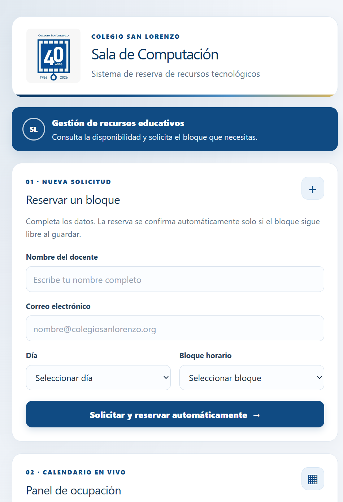

# Sistema de reserva de Sala de Computación

Aplicación web del **Colegio San Lorenzo** para consultar la disponibilidad y
gestionar reservas de la Sala de Computación. Los docentes pueden solicitar un
bloque indicando su nombre y correo, y el sistema registra la reserva
directamente en el calendario compartido de Excel. El calendario muestra quién
ocupa cada bloque; cuando el correo está configurado, se notifica al docente si
su solicitud fue confirmada o rechazada.

## Tecnologías utilizadas

- **Python 3.11**, con **Flask 3.1** para el servidor web.
- **Jinja** para generar las páginas HTML.
- **HTML, CSS y JavaScript** para la interfaz; Tailwind CSS se carga desde su
  CDN.
- **Excel `.xlsx` y openpyxl** para leer y actualizar el calendario.
- **filelock** para coordinar el acceso al archivo cuando llegan reservas
  simultáneas.
- **SMTP** para enviar notificaciones por correo.
- **Gunicorn** como servidor WSGI para producción.
- **Flask-SQLAlchemy y SQLAlchemy** están incluidos como dependencias, pero
  actualmente la aplicación no los utiliza para almacenar reservas.

## Estructura del proyecto

```text
.
├── app.py                         # Punto de entrada de Flask
├── excel_utils.py                 # Lectura, reserva y liberación de bloques Excel
├── calendario_sala.xlsx           # Calendario utilizado por la aplicación
├── calendario_sala_respaldo.xlsx  # Copia de respaldo del calendario
├── requirements.txt               # Dependencias de Python
├── app/
│   ├── __init__.py                # Creación y configuración de la aplicación
│   ├── config.py                  # Configuración, correo y ruta del calendario
│   ├── database.py                # Extensión SQLAlchemy (no activa actualmente)
│   ├── models.py                  # Reservado para modelos (sin uso actualmente)
│   ├── routes.py                  # Rutas web y validación de solicitudes
│   └── services.py                # Reservas y notificaciones por correo
├── templates/
│   ├── base.html                  # Plantilla base
│   └── index.html                 # Página principal y panel de ocupación
├── static/
│   ├── css/style.css              # Estilos de la aplicación
│   ├── js/script.js               # JavaScript del cliente
│   └── img/
│       ├── colegio-san-lorenzo.png
│       └── captura-pagina-principal.png
├── tests/
│   └── test_excel_utils.py        # Pruebas de lectura y reserva del calendario
└── probar_excel.py                # Utilidad para probar el manejo de Excel
```

## Rutas del proyecto

### Rutas web

| Ruta | Método | Descripción |
| --- | --- | --- |
| `/` | `GET` | Muestra el formulario de reserva y el calendario de ocupación. |
| `/` | `POST` | Valida y registra una reserva si el bloque continúa disponible. |
| `/liberar` | `POST` | Libera un bloque ocupado tras validar la contraseña de administrador. |

### Archivos principales

- `app/routes.py`: define las rutas, valida los datos y presenta los mensajes.
- `app/services.py`: procesa las reservas y envía las notificaciones SMTP.
- `app/config.py`: configura la aplicación y localiza el libro Excel en la raíz.
- `excel_utils.py`: consulta y modifica el calendario con bloqueo de archivo.
- `templates/index.html`: contiene la página principal, el formulario y la tabla.
- `static/`: reúne hojas de estilo, JavaScript e imágenes.

## Base de datos y almacenamiento

El proyecto **no utiliza actualmente una base de datos SQL**. Las reservas se
almacenan en `calendario_sala.xlsx`, en la hoja configurada con `EXCEL_HOJA`
(por defecto, `Hoja1`). `calendario_sala_respaldo.xlsx` es una copia de
respaldo; la aplicación no la actualiza automáticamente.

La aplicación coordina las operaciones sobre el libro con `filelock` para
evitar que dos solicitudes simultáneas ocupen el mismo bloque. Aunque el
proyecto incluye Flask-SQLAlchemy y un módulo `app/database.py`, no hay modelos
ni una base SQL configurada para las reservas.

## Funcionalidades

- Consulta de disponibilidad semanal de lunes a viernes y cuatro bloques
  horarios diarios.
- Registro de reservas con nombre y correo electrónico, con validación de los
  datos enviados.
- Confirmación automática solo cuando el bloque sigue libre al guardar.
- Protección contra reservas simultáneas del mismo bloque.
- Notificación por correo de la confirmación o del rechazo, si se configura
  SMTP.
- Liberación de bloques ocupados mediante una contraseña de administrador.
- Mensajes en pantalla para informar el resultado de las operaciones.

## Cómo ejecutar y desplegar

### Ejecución local en Windows

Se recomienda usar Python 3.11, indicado en `.python-version`. Desde la raíz
del repositorio, crea un entorno virtual e instala las dependencias:

```powershell
py -3.11 -m venv .venv
.\.venv\Scripts\Activate.ps1
python -m pip install --upgrade pip
pip install -r requirements.txt
```

Crea un archivo `.env` en la raíz (no lo subas al repositorio) y configura las
variables que correspondan:

```dotenv
SECRET_KEY=una-clave-aleatoria-larga
ADMIN_PASSWORD=una-clave-de-administrador-segura
EXCEL_HOJA=Hoja1
MAIL_SERVER=smtp.gmail.com
MAIL_PORT=587
MAIL_USE_TLS=true
MAIL_USERNAME=cuenta-de-correo
MAIL_PASSWORD=clave-de-aplicacion
```

`ADMIN_PASSWORD` protege la liberación de bloques. Las credenciales SMTP
permiten enviar correos; si no se configuran, la reserva puede quedar
registrada, pero no se enviará la notificación. Comprueba que `EXCEL_HOJA`
coincida con el nombre de la hoja del libro.

Inicia la aplicación:

```powershell
python app.py
```

Abre [http://127.0.0.1:5000](http://127.0.0.1:5000).

### Despliegue en producción

En un servicio compatible con Python y Gunicorn, configura como comando de
instalación:

```sh
pip install -r requirements.txt
```

Y como comando de inicio:

```sh
gunicorn app:app --bind 0.0.0.0:$PORT
```

Configura en el proveedor las variables `SECRET_KEY`, `ADMIN_PASSWORD` y
`EXCEL_HOJA`; agrega `MAIL_SERVER`, `MAIL_PORT`, `MAIL_USE_TLS`,
`MAIL_USERNAME` y `MAIL_PASSWORD` si necesitas notificaciones por correo. Usa
valores secretos propios y no publiques las credenciales.

**Importante sobre el despliegue:** el calendario se guarda en
`calendario_sala.xlsx`, dentro de la raíz del proyecto. Despliega en un entorno
con almacenamiento persistente y asegúrate de que el libro siga disponible y
escribible en esa ruta. En servicios con disco efímero, las reservas podrían
perderse al reiniciar o volver a desplegar la aplicación. Si el proveedor monta
el disco en otra ruta, habrá que adaptar `EXCEL_PATH` en `app/config.py` para
que apunte al archivo persistente.

Para ejecutar las pruebas:

```powershell
python -m unittest discover -s tests
```

## Integrantes

- Vicente Quiroz
- Elder Cruzado
- César Ramirez
- Pascal Diaz
- Gabriel Vásquez

## Captura de pantalla de la página principal


